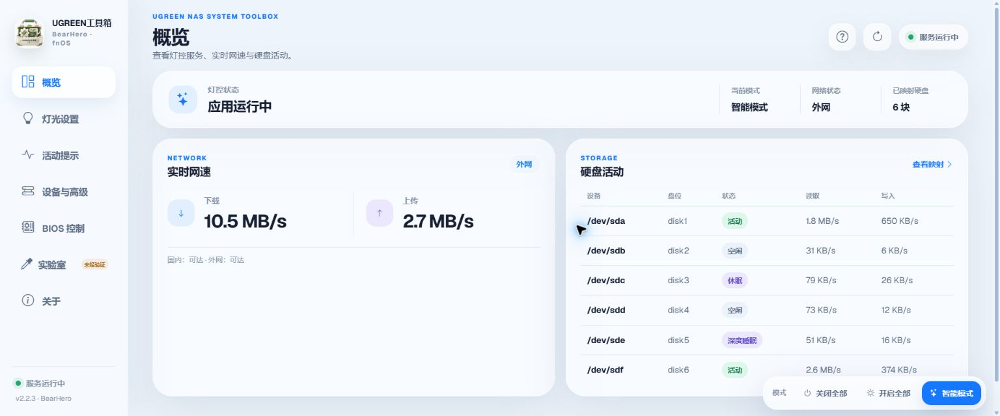
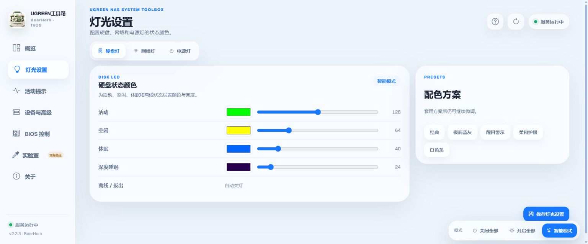
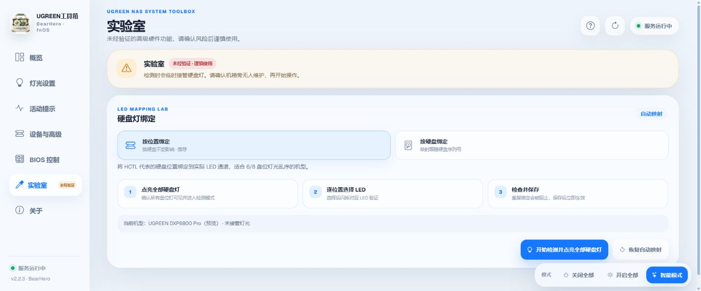
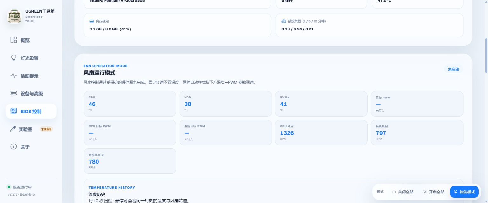
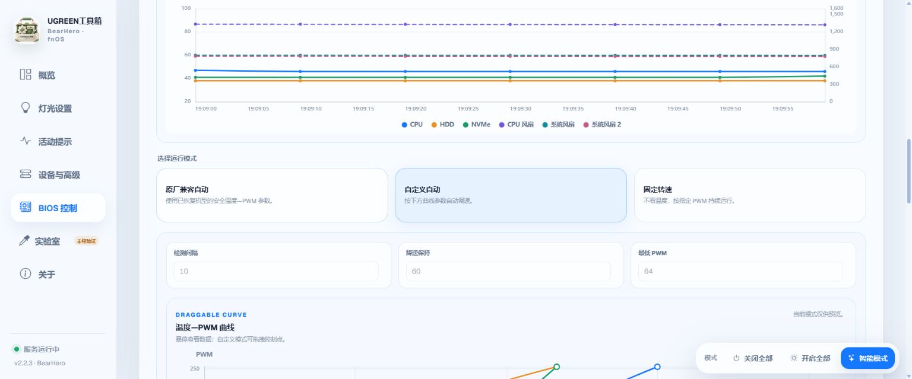
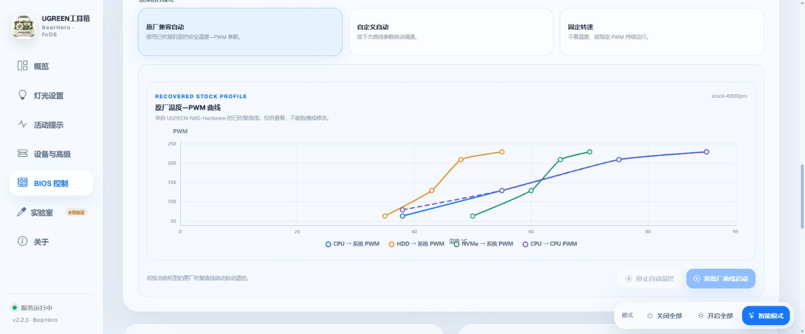

# UGreen Control 3.2.9

绿联 NAS 灯光、硬件监控与 BIOS 管理工具，适用于飞牛 fnOS x86 设备。

[下载安装包](https://github.com/BearHero520/UGreen-Control/releases/tag/v3.2.9) · [项目源码](https://github.com/BearHero520/UGreen-Control) · [问题反馈](https://github.com/BearHero520/UGreen-Control/issues)

## 当前版本

3.2.9 修复 DXP8800 系列根端口桥识别（`00:1d.0` / `00:1d.2`，`8086:51b0` / `51b2`）、DXP2800 EM26 与 iDX6011/6012 OEM V3.0 等机型物理盘位映射；增强 LED MCU (`0x3a`) I2C 锁等待、ACK 轮询、写入回读重试及 DX4600/DXP4800S 多总线探测；修复重映射失败时覆盖已有盘位映射与机型配置归一问题。

应用支持灯光模式、硬盘活动灯、网络灯、机型与盘位识别，以及在兼容机型上的风扇调速、温控、来电启动、WOL 和 RTC 定时开关机。不同机型的功能以应用内检测结果为准。

## 更新历史

| 版本 | 日期 | 主要更新 |
| --- | --- | --- |
| [3.2.9](https://github.com/BearHero520/UGreen-Control/releases/tag/v3.2.9) | 2026-11-26 | 修复 DXP8800 系列、DXP2800 EM26 与 iDX6011/6012 OEM V3.0 盘位映射，增强 LED MCU I2C 韧性与多总线探测。 |
| [3.2.0](https://github.com/BearHero520/UGreen-Control/releases/tag/v3.2.0) | 2026-11-16 | 增加 iDX6012 灯光、风扇与电源管理，接入 DXP4800 GT 八点温控。 |
| [3.0.9](https://github.com/BearHero520/UGreen-Control/releases/tag/v3.0.9) | 2026-11-05 | 增加 DXP8800 Pro 风扇调速、转速读取、来电恢复和软件温控曲线。 |
| [3.0.7](https://github.com/BearHero520/UGreen-Control/releases/tag/v3.0.7) | 2026-10-28 | 改进关于页面和项目说明展示。 |
| [3.0.6](https://github.com/BearHero520/UGreen-Control/releases/tag/v3.0.6) | 2026-10-28 | 统一使用 UGREEN-NAS-Hardware v0.3.0。 |
| [3.0.5](https://github.com/BearHero520/UGreen-Control/releases/tag/v3.0.5) | 2026-10-28 | 完成项目仓库迁移并接入新的硬件后端。 |
| [2.2.3](https://github.com/BearHero520/UGreen-Control/releases/tag/v2.2.3) | 2026-10-09 | 缓解 DX4600 的总线忙问题，合并灯状态读取并改进失败重试。 |
| [2.2.0](https://github.com/BearHero520/UGreen-Control/releases/tag/v2.2.0) | 2026-09-19 | 增加 DXP6800 Plus 风扇与来电启动策略。 |
| [2.1.0](https://github.com/BearHero520/UGreen-Control/releases/tag/v2.1.0) | 2026-08-27 | 更名为 UGREEN 工具箱，增加关于页面和新版图标。 |

完整的版本、安装包大小和 SHA256 已同步到源索引的 `releases` 字段。

## 界面截图

截图来自 2.2.3 的飞牛桌面界面，当前版本的具体硬件能力以应用内检测结果为准。

### 总览

### 灯光设置

### 盘位映射

### BIOS 与风扇

### 电源管理

## 安装要求

- fnOS 0.9.27 或更高版本
- x86 平台
- 安装和硬件控制需要 root 权限

请勿与其他 LED 控制程序同时运行。实验性和待验证机型建议先使用应用内的兼容性检测。

## 许可

项目自有代码采用 [GNU Affero General Public License v3.0 only](https://github.com/BearHero520/UGreen-Control/blob/v3.2.9/LICENSE) 授权。
